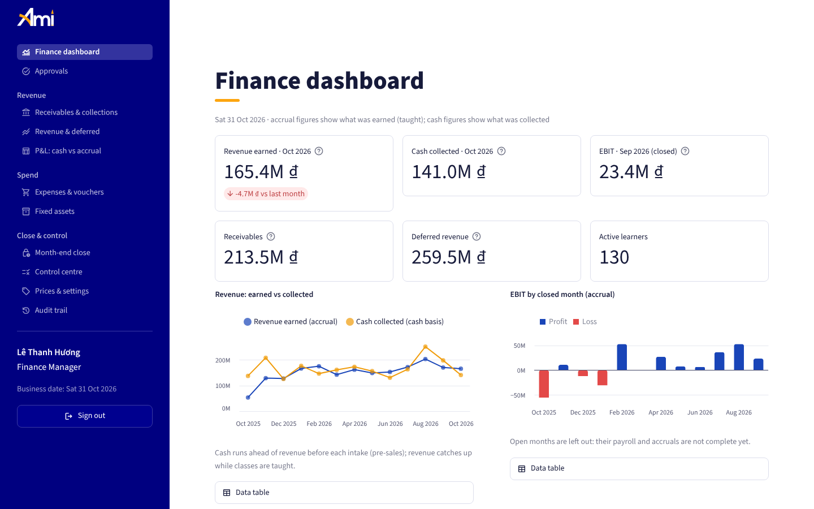
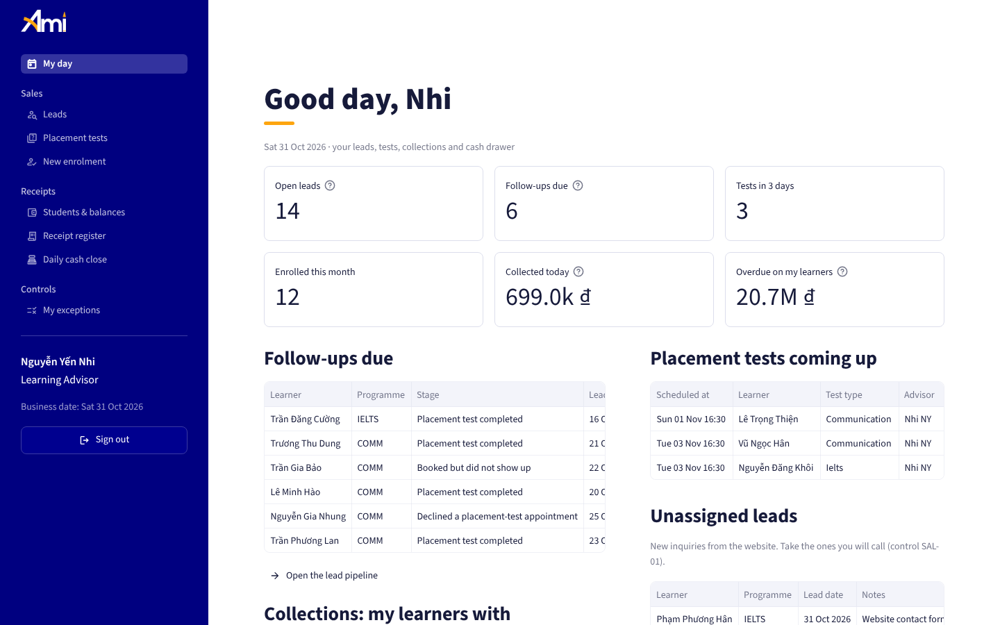
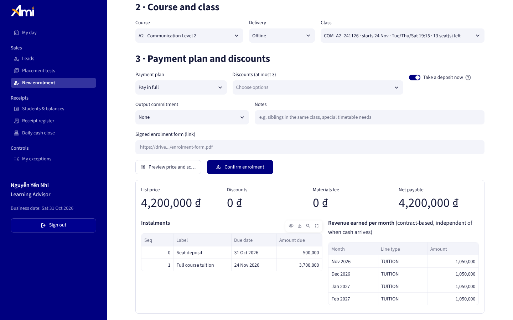
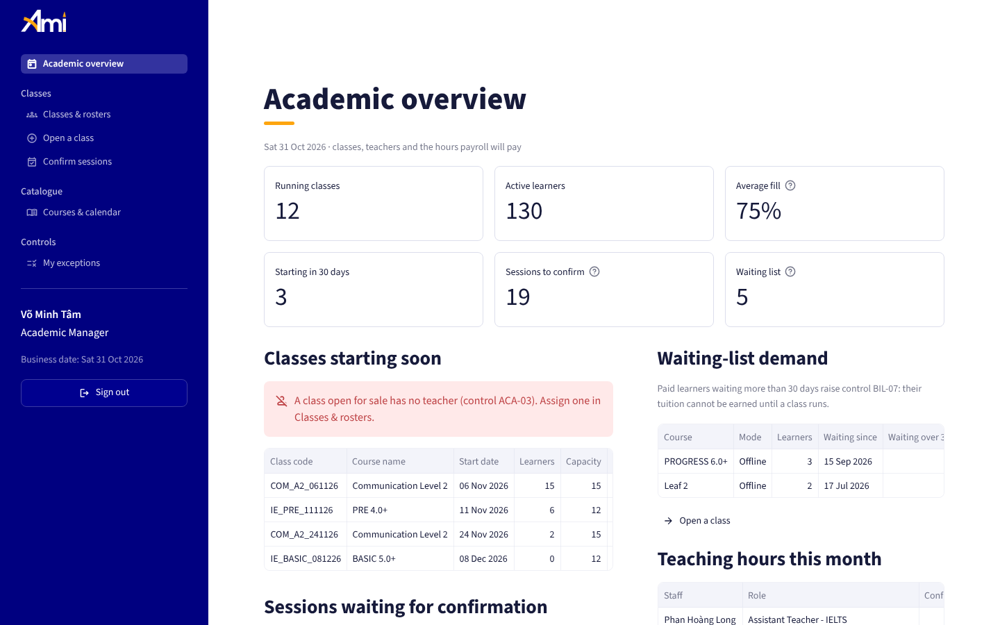
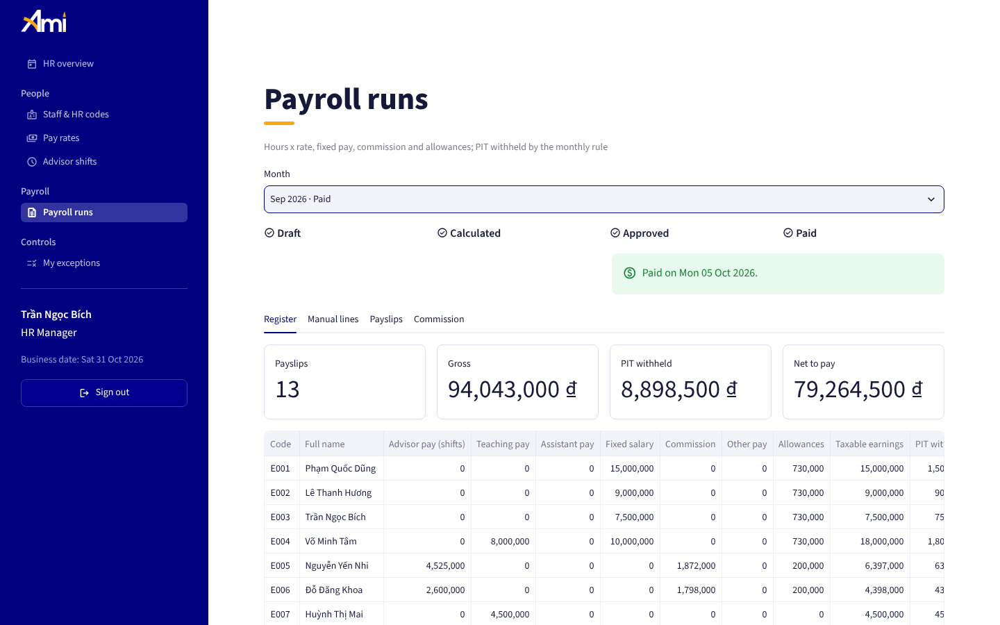
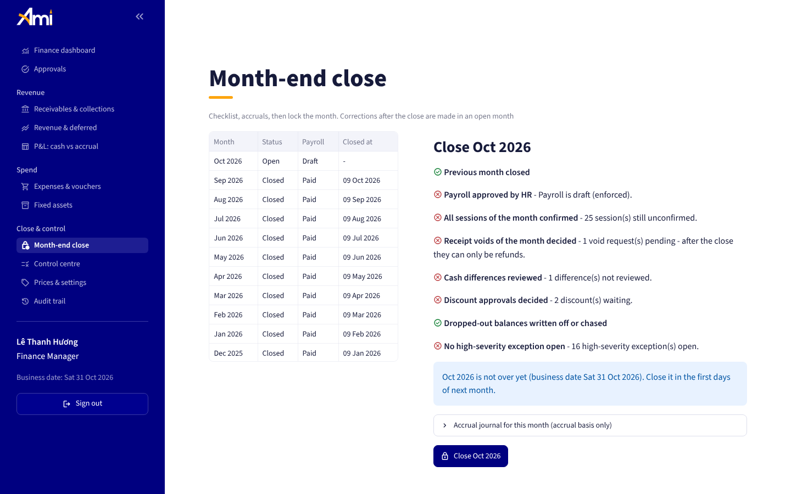
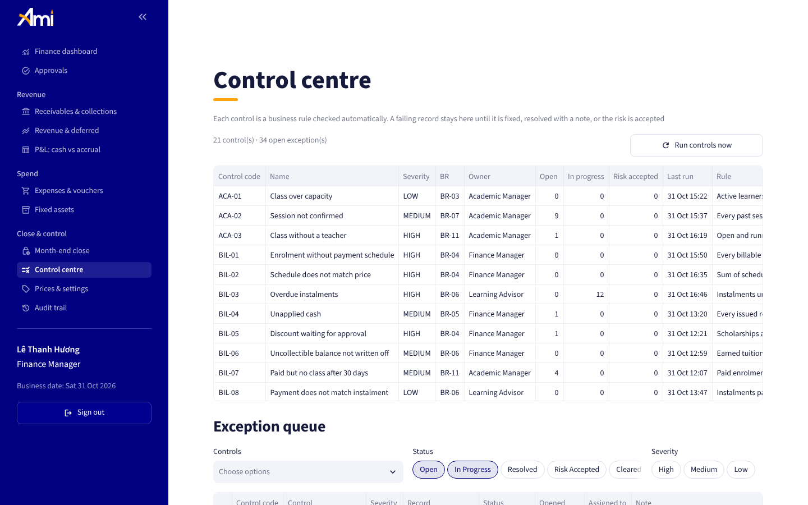
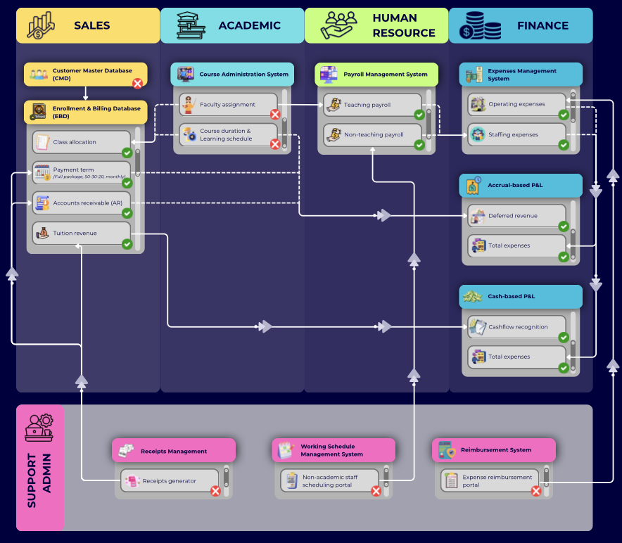
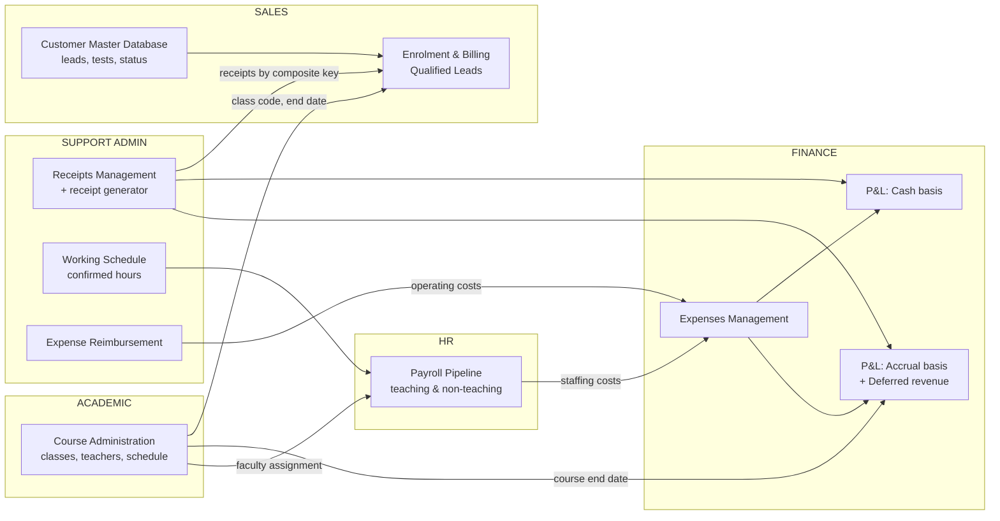
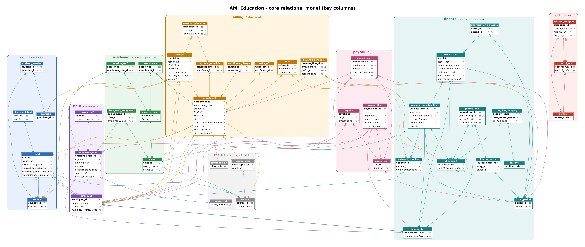

# AMI Operations Platform: from five Excel workbooks to a role-based operating system

**AMI Education** is an English-language training centre in Bạc Liêu, Vietnam, which I co-founded and led as CEO (2024-2025).
Its sales, academic, HR, finance and admin processes first ran on a zero-cost system of five linked Excel/SharePoint workbooks:
**lead → placement test → enrolment → class → receipt → payroll → expense → P&L (cash and accrual)**.

This repository is **phase 2 of the AMI Operational System**: it takes that system to the next level in three layers:

| Layer | What it is | Start here |
|---|---|---|
| **1. The workbooks** | The Excel system as it ran, sanitised | [`workbooks/`](workbooks), [module docs](#module-documentation) |
| **2. The relational model** | The same business logic in PostgreSQL: 93 tables, the rules as constraints, triggers and functions, 21 operational controls, 70 business-rule tests | [`database/`](database) |
| **3. The application** | A Streamlit web app on that database where each role works in its own workspace, with a year of simulated operations to explore | [`streamlit_app.py`](streamlit_app.py), [`ami/`](ami), [`seed/`](seed) |

> All data in this repository is **synthetic**: people, phone numbers and amounts are fictitious. Names are Vietnamese; amounts are in VND.



---

## The application

**Staff enter data; managers decide.** Learning Advisors are the only staff who enter data, and only for sales and receipts.
Everything else belongs to a manager: the Academic Manager runs classes and confirms what was taught, the HR Manager runs pay, and
the Finance Manager approves, closes and reports. A Director can read everything and change nothing.

| Role | Workspace |
|---|---|
| **Learning Advisor** | My day (follow-ups, tests, collections, cash drawer) · Leads · Placement tests · New enrolment (price, instalments and revenue months previewed before saving) · Students & balances (take a payment, PDF receipt, drop / defer / cancel) · Receipt register (request a void) · Daily cash close · My exceptions |
| **Academic Manager** | Overview (classes starting, sessions to confirm, waiting-list demand) · Classes & rosters · Open a class (timetable → all sessions, holidays skipped) · Confirm sessions · Courses & calendar · My exceptions |
| **HR Manager** | Overview · Staff & HR codes (dated roles and contract stages) · Pay rates · Advisor shifts · Payroll runs (calculate → approve → payslips) · My exceptions |
| **Finance Manager** | Dashboard · Approvals (discounts, voids, cash differences, claims) · Receivables & collections · Revenue & deferred · P&L cash vs accrual · Expenses & vouchers · Fixed assets · Month-end close · Control centre · Prices & settings · Audit trail |
| **Director** | Read-only dashboard, P&L, revenue, receivables, classes, controls, audit trail |

| | |
|---|---|
|  |  |
| **Learning Advisor - My day.** Follow-ups, tests, overdue instalments of their own learners, the cash drawer. | **New enrolment.** The database prices the enrolment, builds the instalments and the revenue months - shown before anything is saved. |
|  |  |
| **Academic Manager.** A class open for sale without a teacher, sessions waiting for confirmation, paid learners waiting for a class. | **HR Manager.** Payroll moves from draft to calculated, approved and paid; approval is refused while sessions are unconfirmed. |
|  |  |
| **Month-end close.** The checklist; the database closes months in order and only after HR approved payroll. | **Control centre.** 21 business rules checked every night; each failing record is a work item with an owner. |

### How it works in operations

- **Receipts are never edited.** A wrong receipt is voided only with the Finance Manager's approval and stays in the register as VOID;
  every collector closes the cash drawer daily against the receipts issued, and differences stay open until Finance reviews them.
- **Discounts outside policy wait for approval.** A scholarship, or a total discount above the threshold, is saved but flagged; if
  Finance refuses, the enrolment is re-priced and any difference becomes a new instalment.
- **Revenue follows the contract, not the cash.** Net tuition is earned month by month while the class runs, whatever the payment plan.
  A drop-out earns what was served; payments kept are earned under the non-refundable rule; a cancellation keeps only the deposit.
  The gap between cash kept and revenue earned is deferred revenue - shown as what it is, teaching still owed.
- **Payroll is paid on confirmed work.** Teachers are paid for sessions the Academic Manager confirmed, at the rate valid on each date;
  advisors for confirmed shifts plus commission from a configurable rule. HR cannot approve a month with unconfirmed sessions.
- **Books close.** Months close in order, only after payroll approval; nothing dated in a closed month can change afterwards.
- **The database is the gatekeeper.** Every transaction runs under the user's PostgreSQL role. An advisor can *record* a receipt but
  not *edit* one, even with direct SQL access. Every financially significant change is written to an audit trail by trigger.

### The demo year

[`seed/generate_dataset.py`](seed/generate_dataset.py) simulates twelve months of a new campus - 13 staff, 46 classes, ~780 leads,
~540 enrolments, ~1,700 receipts, 1,700 sessions, monthly payroll, expenses, fixed assets and twelve month-end closes - **through the
same database functions the application calls**, signed in as the employee who would do each thing. So every price, instalment, revenue
line, payslip, control exception and audit entry was produced by the real rules. The business date (31 Oct 2026) has work waiting for
each role: website leads to assign, sessions to confirm, a teacher who just resigned, a payroll to calculate, approvals, a cash difference
and an unreviewed capital purchase.

### Run it

```bash
createdb ami_demo
(cd database && psql -v ON_ERROR_STOP=1 -d ami_demo -f build.sql)
psql -v ON_ERROR_STOP=1 -d ami_demo -f seed/demo_dataset.sql
pip install -r requirements.txt
DATABASE_URL=postgresql:///ami_demo streamlit run streamlit_app.py      # demo password: ami-demo
```

Hosting on Supabase + Streamlit Community Cloud (free tiers), with a weekly GitHub Action that regenerates the demo up to the current
date: see [docs/DEPLOYMENT.md](docs/DEPLOYMENT.md).

### Tests

| Suite | What it proves |
|---|---|
| [`database/08_tests.sql`](database/08_tests.sql) - 70 tests | Pricing, schedules, allocation, revenue and deferred revenue, both P&L bases, payroll, approvals, voids, drop-outs, write-offs, cash close, period close, audit trail, and the privileges of each role |
| [`tests/test_0_dataset.py`](tests/test_0_dataset.py) | The generated year obeys the rules it was generated through (books reconcile every month) |
| [`tests/test_app.py`](tests/test_app.py) | Every page for every role, then one business day through the screens: lead → test → enrolment → receipt → void → approvals → payroll refused → sessions confirmed → payroll approved → month closed → receipt in the closed month refused |

CI ([`.github/workflows/ci.yml`](.github/workflows/ci.yml)) runs all three on every push.

### Documentation

| Document | |
|---|---|
| [docs/ROLE_GUIDE.md](docs/ROLE_GUIDE.md) | Who does what: the daily, weekly and month-end routine of each role |
| [docs/BUSINESS_RULES.md](docs/BUSINESS_RULES.md) | BR-01 … BR-12 of the specification → database object → screen → test |
| [docs/ERD_MAPPING.md](docs/ERD_MAPPING.md) | The simplified logical model (25 entities) → the 93 physical tables, and the three logic chains |
| [docs/DEPLOYMENT.md](docs/DEPLOYMENT.md) | Supabase, Streamlit Community Cloud, weekly reset, local run |
| [database/README.md](database/README.md) | The relational model: files, schemas, quick start, queries |
| [database/docs/DESIGN_NOTES.md](database/docs/DESIGN_NOTES.md) | 19 design decisions and the rule → constraint → test map |
| [database/docs/ERD.md](database/docs/ERD.md) · [DATA_DICTIONARY.md](database/docs/DATA_DICTIONARY.md) | Diagrams per module; all 650 columns (generated from the catalog) |

### Repository layout

```
streamlit_app.py          entry point: sign-in, role -> workspace
ami/                      application: config, db (role per transaction), auth, ui, charts, pdf, pages/<role>/...
ami/assets/               brand logos (AMI navy #000080, amber #FDA50F) and the PDF fonts
database/                 01_schema … 06_security (build.sql), 07_test_fixture, 08_tests, docs/, tools/
seed/                     generate_dataset.py (simulated year), export_dataset.sh, demo_dataset.sql (generated)
deploy/                   deploy.sh (Supabase), supabase_setup.sql (app login), reset_demo.sh
tests/                    pytest: dataset invariants, application end-to-end
workbooks/                the original Excel system (sanitised)
docs/                     role guide, business rules, ERD mapping, deployment, module docs of the Excel system
```

---

## The Excel system it started from

### Architecture



| Marker | Meaning |
|---|---|
| ✗ (red) | **Manual input point.** A staff member enters data here (lead details, faculty assignment, class schedule, receipts, working hours, expense claims). |
| ✓ (green) | **Automated.** The value is calculated by formulas and lookups from upstream inputs. No re-typing is needed. |

The design principle was **enter once, reuse everywhere**. Each fact (a student, a payment, an hour worked, an invoice) is typed in exactly one place. Every downstream report pulls it through lookups, keyed on stable codes (customer code, class code, HR code, receipt/voucher number, P&L code).

#### Data flow



---

### Workbooks

| # | Workbook | Function | Key sheets |
|---|---|---|---|
| 01 | [`01_Customer_Management_Database.xlsx`](workbooks/01_Customer_Management_Database.xlsx) | Sales CRM, enrolment and billing, receipts | `Customer Management Database`, `Qualified Leads`, `Receipts Management`, `Receipt` |
| 02 | [`02_Learning_Course_Management.xlsx`](workbooks/02_Learning_Course_Management.xlsx) | Course administration | `Khoá học khai giảng` (class register), one roster sheet per class |
| 03 | [`03_Monthly_Payslip_Apr_2025.xlsx`](workbooks/03_Monthly_Payslip_Apr_2025.xlsx) | Payroll (one month) | `Working Schedule_Apr 2025`, `Pipeline`, `Bảng lương_Breakdown`, `Bảng lương`, one payslip per employee |
| 04 | [`04_Payment_Control.xlsx`](workbooks/04_Payment_Control.xlsx) | Expense vouchers and reimbursement | `Payment Management`, `Expense Reimbursement Form` |
| 05 | [`05_Profit_and_Loss.xlsx`](workbooks/05_Profit_and_Loss.xlsx) | Chart of accounts, expenses, revenue recognition, P&L | `Expenses Management`, `Receipt Control`, `Profit and Loss_Cashflow`, `Profit and Loss_Accrual`, `Deferred Revenue Balance` |

The working language of the original system was Vietnamese, so sheet names and column headers are in Vietnamese. Each module document below includes an English glossary.

### Module documentation

1. [Sales: CRM, enrolment and billing](docs/01-sales-crm.md)
2. [Academic: course administration](docs/02-course-administration.md)
3. [HR: payroll pipeline](docs/03-payroll.md)
4. [Finance: expense management](docs/04-expense-management.md)
5. [Finance: P&L, cash vs accrual, deferred revenue](docs/05-pnl-revenue-recognition.md)

### Logic highlights

- **Tuition pricing engine.** List price comes from the class code. Up to three percentage discounts plus a fixed group discount are applied. A materials fee is added for instalment plans, and the deposit is deducted to give the balance due.
- **Receipt reconciliation by composite key.** Every receipt carries a key such as `AMI15-Hoàn thành học phí theo lộ trình-Giai đoạn 1` (customer, payment type, instalment). The billing sheet looks up each planned instalment by key. Outstanding balance, collected revenue and bad debt (for students who drop out or defer) then update automatically.
- **Self-updating class status.** `TODAY()`-driven logic labels each class as *not started*, *starting in N days*, *running*, *ending in N days* or *finished*.
- **Payroll from confirmed hours.** Hourly rates are keyed on an HR code (person + role + contract stage). They are multiplied by confirmed hours per programme, split into teaching and non-teaching pay, and reconciled against each individual payslip with a *Balance Check*.
- **Coded expenses.** Every voucher carries a cost center (9210xx), an expense category (one of about 130 codes, E0–E8) and a VAT group (0%, 8%, 10%). The data rolls up by month into a full P&L structure.
- **Two P&L views.** The *cash* view recognises tuition when it is received. The *accrual* view spreads full-course and 50-30-20 payments evenly from the payment month to the course end date. The difference is reported as **deferred revenue**, together with an accrual-to-cash ratio and a coverage check against total expenses.

### From workbooks to the relational model

The workbooks proved the process; [`database/`](database) shows how it scales. Receipts are allocated to instalments instead of matched
by a text key; prices, rates and tax rules are dated; revenue is a stored schedule; periods lock; controls are a queue. See
[database/README.md](database/README.md) and [DESIGN_NOTES.md](database/docs/DESIGN_NOTES.md).



### Opening the workbooks

- Use **Excel for Microsoft 365** (or Excel 2021+). The workbooks rely on dynamic-array functions (`FILTER`, `XLOOKUP`, `IFS`), structured table references and PivotTables.
- LibreOffice 24.x and older recalculates on open. It does not support `FILTER`/`XLOOKUP`, so those cells show `#NAME?` or `0`, and the P&L workbook's `Receipt` sheet opens slowly. The logo cells show `#VALUE!` because LibreOffice does not support images placed in cells.
- In production the workbooks were linked to each other through SharePoint (for example, the P&L pulled vouchers from *Payment Control* and receipts from the *Customer Management Database*). In this public version those links are **frozen as static snapshots** so each file opens on its own. The receiving sheets are `Payment Control`, `Receipt Control`, `Product Lines` and `CMD.copy.source` in the P&L workbook, and `Working Schedule_Apr 2025` and `Salary Pipeline` in the payroll workbook.

## Data privacy

The application's data (the demo year and the test fixture) is **generated**: no record comes from the real centre.

The workbooks are a **sanitised replica** of the production files:

- **People:** every student, parent, payer and staff name is replaced with a fictitious name. Short codes, HR codes and payslip sheet names are replaced consistently, so lookups still resolve. Phone numbers use a retired prefix, emails use `example.com`, and dates of birth are shifted.
- **Money:** every amount (prices, receipts, salaries, rates, expenses and P&L totals) is multiplied by an **undisclosed factor** and rounded. Ratios, trends and the logic are preserved. Absolute values are not real. The statutory 2,000,000 VND personal-income-tax withholding threshold is kept as a rule.
- **Company:** tax ID, street address and hotline are masked. Comments, author metadata and internal SharePoint/OneDrive paths are removed.
- **Third-party content:** the original P&L file contained hidden template sheets from another organisation. They have been removed.
- **Brand:** the AMI Education name and logo (`ami/assets/brand/`) belong to AMI Education and are used here to present the author's own work.

## Skills demonstrated

Business process design and internal controls (segregation of duties, approvals, cash handling, month-end close) · relational data
modelling in PostgreSQL (normalisation, composite and exclusion constraints, triggers, PL/pgSQL, row-level security, role-based
privileges) · revenue recognition (contract-based accrual, deferred revenue, cash vs accrual P&L) · payroll and cost-centre accounting ·
Python application development (Streamlit, psycopg, Altair, ReportLab) · synthetic data simulation · automated testing (SQL, pytest,
Streamlit AppTest) and CI with GitHub Actions · cloud deployment (Supabase) · Excel dynamic arrays and SharePoint integration ·
documentation of standard operating procedures.

## Author

**Dat Huynh**. Co-founder and former CEO of AMI Education. Master of Big Data Analytics student at Trent University, Canada.
