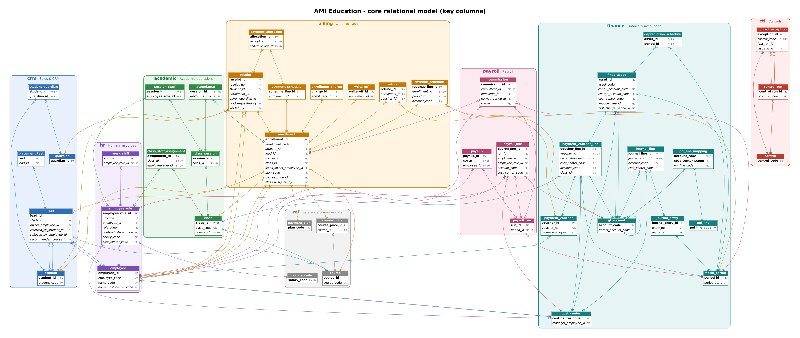

# Relational model (PostgreSQL)

The Excel/SharePoint system in this repository, rebuilt as one normalised PostgreSQL database and used as the backend of the
[AMI Operations application](../README.md): **10 schemas, 93 tables, 175 foreign keys, 38 views, 54 functions and 47 triggers**.
The business rules that lived in workbook formulas now live in keys, constraints, triggers and functions; five database roles decide
who may do what; and **70 automated tests** show that each rule holds.



| Document | What it covers |
|---|---|
| [docs/ERD.md](docs/ERD.md) | The core model above, plus one Mermaid ER diagram per business module (renders on GitHub) |
| [docs/DATA_DICTIONARY.md](docs/DATA_DICTIONARY.md) | Every table, all 650 columns (type, nullability, default, keys, description), constraints, triggers, indexes, views and functions |
| [docs/DESIGN_NOTES.md](docs/DESIGN_NOTES.md) | Why the model looks the way it does: workbook → table lineage, 19 design decisions, and a rule → constraint → test map |

## Quick start

Requires **PostgreSQL 15 or later** (tested on 16) with `pgcrypto` and `btree_gist` (bundled with PostgreSQL; enabled on Supabase).

```bash
createdb ami
psql -v ON_ERROR_STOP=1 -d ami -f database/build.sql            # schema, rules, views, comments, reference data, security
psql -v ON_ERROR_STOP=1 -d ami -f seed/demo_dataset.sql         # a simulated year of operations (for the application)

# or, for the tests:
createdb ami_test
psql -v ON_ERROR_STOP=1 -d ami_test -f database/build.sql
psql -v ON_ERROR_STOP=1 -d ami_test -f database/07_test_fixture.sql
psql -v ON_ERROR_STOP=1 -d ami_test -f database/08_tests.sql    # 70 business-rule tests (rolled back)
```

Expected end of the test run:

```
NOTICE:  PASS  T67 HR cannot approve discounts
NOTICE:  PASS  T68 the Director reads everything and changes nothing
All 70 tests passed - transaction rolled back, fixture unchanged.
```

## Files

| File | Content |
|---|---|
| [`01_schema.sql`](01_schema.sql) | Schemas, domains, all tables with constraints, integrity triggers, period lock and audit trigger. Every table and column is documented inline. |
| [`02_functions.sql`](02_functions.sql) | Business rules and the **application API**: pricing, schedules, FIFO allocation, contract-based revenue recognition, enrolment life cycle, approvals, voids, refunds, write-offs, class opening and session confirmation, payroll calculation / approval / payment, commissions, cash close, period close, controls, sign-in. |
| [`03_views.sql`](03_views.sql) | 17 reporting views (`rpt`) and 21 control check views (`ctl.v_chk_*`). |
| [`04_comments.sql`](04_comments.sql) | `COMMENT ON` statements, **generated** from the inline comments by `tools/build_comments.py`. |
| [`05_seed_reference.sql`](05_seed_reference.sql) | Reference data: programmes, 24 courses, plans, discounts, salary codes, GL accounts, P&L layout, closure days, 21 controls, the commission rule (prices and rates are illustrative). |
| [`06_security.sql`](06_security.sql) | Five group roles, the `ami_app` login role, `SECURITY DEFINER` business actions, grants and row-level security. |
| [`07_test_fixture.sql`](07_test_fixture.sql) | A small hand-written scenario (as of 30 June 2025) with planted exceptions - the fixture of the tests. |
| [`08_tests.sql`](08_tests.sql) | Executable specification: pricing, schedules, allocation, revenue and deferred revenue, P&L, payroll, approvals, voids, drop-outs, write-offs, cash close, period close, audit trail, privileges. |
| [`build.sql`](build.sql) | Runs 01-06 in order. |
| [`tools/`](tools) | `build_comments.py` (inline comments → `04_comments.sql`) and `generate_docs.py` (live catalog → data dictionary and diagrams). |

The application's demo data is not hand-written: [`../seed/generate_dataset.py`](../seed/generate_dataset.py) simulates a year of operations
through the same API functions the application calls.

## Schemas

| Schema | Replaces | Main tables |
|---|---|---|
| `crm` | Customer Master Database | student, guardian, lead, lead_activity, lead_stage_history, placement_test |
| `academic` | Course Administration | class, class_meeting_pattern, class_session, class_staff_assignment, session_staff, closure_day |
| `billing` | Qualified Leads, Receipts Management | enrollment, enrollment_discount, enrollment_charge, payment_schedule, receipt, payment_allocation, refund, write_off, revenue_schedule |
| `hr` | Salary Pipeline, Working Schedule | employee, employee_role, employee_fixed_pay, employee_rate_override, work_shift |
| `payroll` | Pipeline, payroll register, payslips | payroll_run, payroll_line, payslip, commission_rule, commission, pit_rule |
| `finance` | Payment Control, Expense Category, P&L | fiscal_period, gl_account, cost_center, pnl_line_mapping, payment_voucher, expense_claim, fixed_asset, journal_entry |
| `ref` | drop-down lists, price lists | course, course_price, payment_plan, discount_programme, salary_code, salary_rate, app_setting |
| `ctl` | *(new)* | control, control_run, control_exception (persistent queue) |
| `app` | *(new)* | app_user, audit_log, cash_close |
| `rpt` | report sheets | v_class_status, v_class_roster, v_enrollment_balance, v_enrollment_revenue_position, v_payroll_register, v_pnl_summary, v_deferred_revenue … |

## What the model does that the workbooks could not

- **Receipts are allocated, not matched by text.** A receipt is applied to schedule lines oldest-due-first; over-allocation is
  impossible and unapplied cash is reported. Receipts are never edited: a void needs the Finance Manager and keeps the receipt.
- **Revenue follows the contract.** Net tuition is earned month by month while the class runs, whatever the payment plan; drop-outs
  earn what was served, kept payments are forfeited under the non-refundable rule, and closed months never move.
- **History is reproducible.** Prices, salary rates and tax rules have validity dates guarded by exclusion constraints, enrolments
  keep the price they were sold at, and every view uses the business date instead of `TODAY()`.
- **Payroll is derived from confirmed work.** Only hours confirmed on delivered sessions or worked shifts are paid; commission comes
  from a configurable rule; payslips must balance; approved runs freeze their sessions.
- **Books close.** Months close in order, only after payroll approval; closed months reject postings; journals balance at commit;
  capital expenditure is depreciated.
- **Problems surface as a queue.** 21 controls run as SQL views; exceptions persist with an owner, a status and a note, clear
  themselves when the data is fixed, and each role sees only its own.
- **Access is enforced by PostgreSQL.** Staff enter sales and receipts; managers decide; the database refuses anything else.

## A few queries

```sql
-- Management P&L, cash vs accrual
select period_id, basis, net_revenue, cost_of_sales, gross_margin, total_indirect_costs, ebit
from rpt.v_pnl_summary where period_id between 202608 and 202609 order by 1, 2;

-- Who owes what, and since when
select enrollment_code, learner, net_payable, collected, outstanding_receivable, overdue_amount, payment_status
from rpt.v_enrollment_balance order by overdue_amount desc limit 10;

-- Open exceptions, most severe first
select control_code, severity, entity_ref, status, detail
from ctl.control_exception where status in ('OPEN', 'IN_PROGRESS')
order by array_position(array['HIGH','MEDIUM','LOW'], severity), control_code, entity_ref;

-- Do the work of the Learning Advisor role, as the database sees it
begin;
set local role ami_learning_advisor;
select billing.record_receipt(…);           -- allowed
update billing.receipt set amount = 1;       -- ERROR: permission denied
rollback;
```

## Regenerating the documentation

```bash
python3 database/tools/build_comments.py                 # after editing comments in 01-03
python3 database/tools/generate_docs.py --db ami          # data dictionary, ERD.md, erd/*.mmd, erd/*.dot
dot -Tpng -Gdpi=110 database/docs/erd/core-model.dot -o docs/images/erd-core-model.png
```
