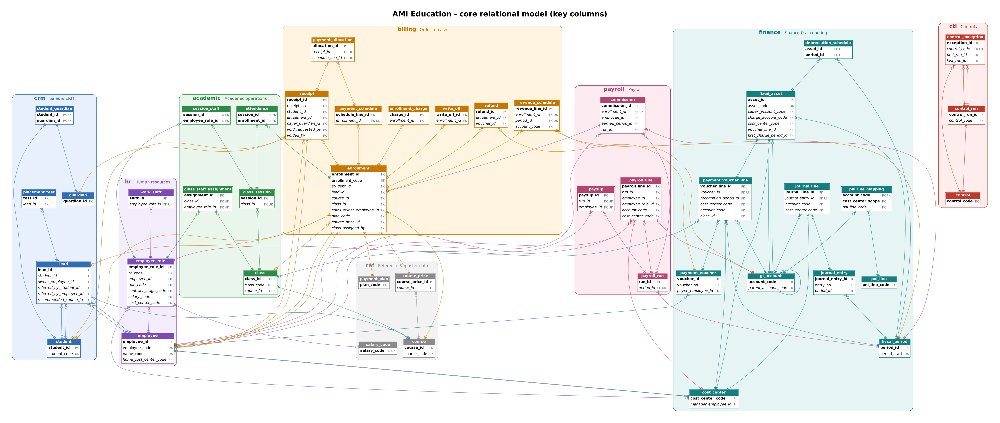
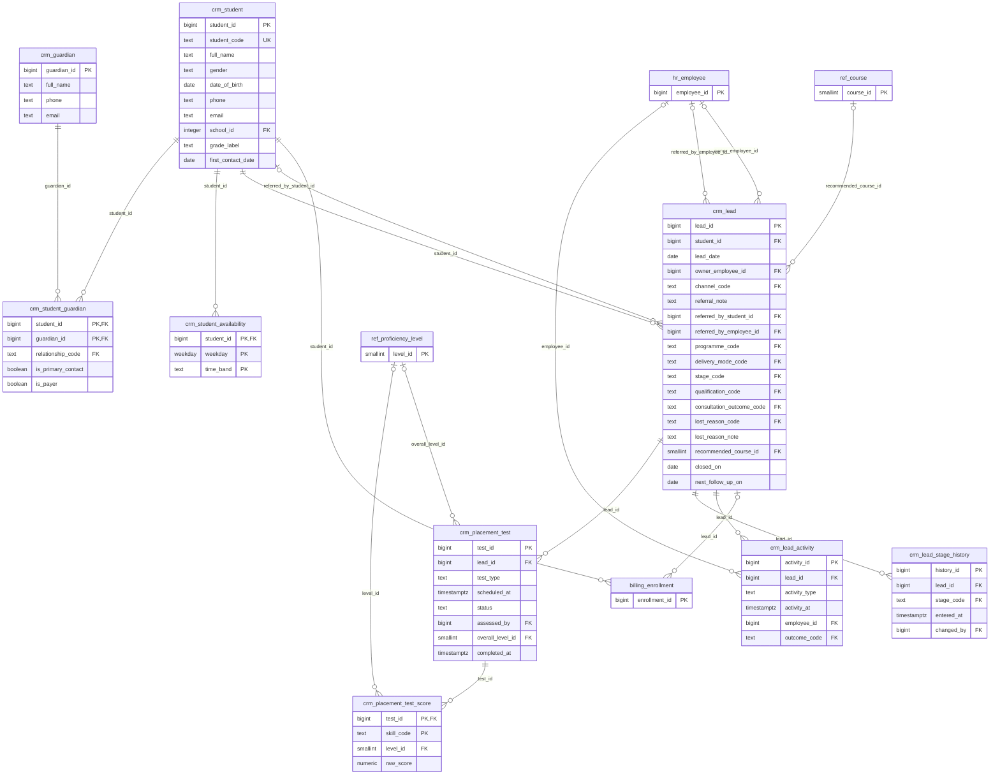
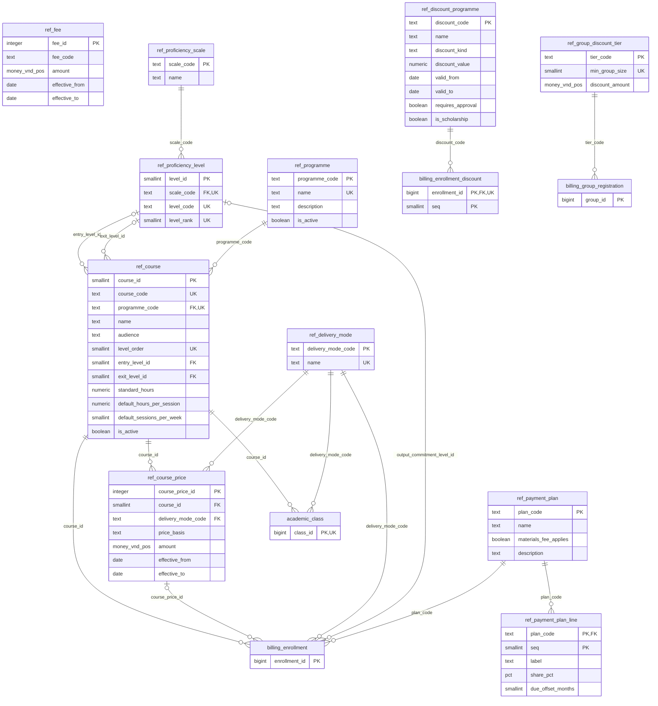
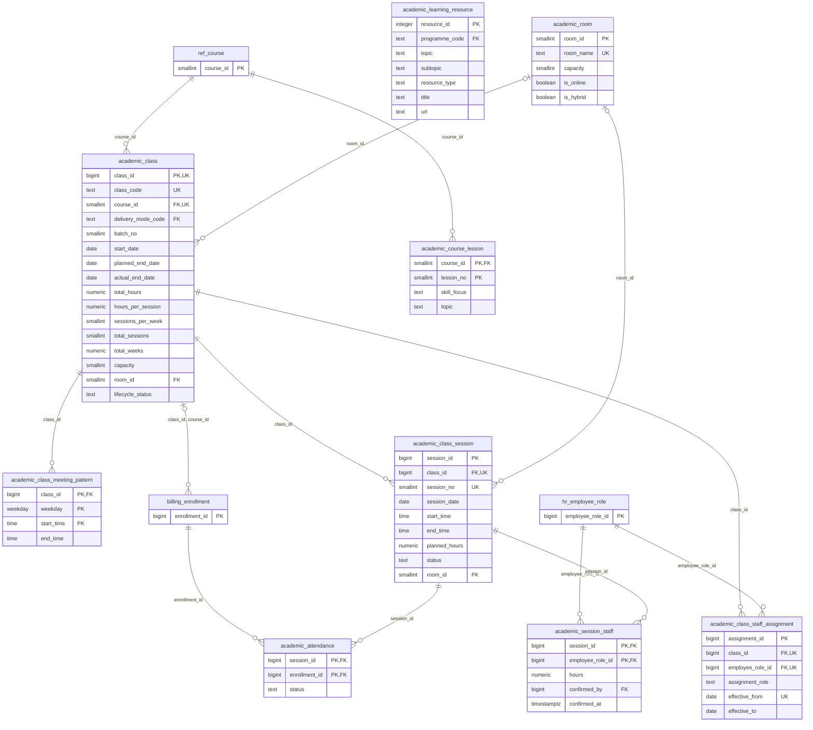
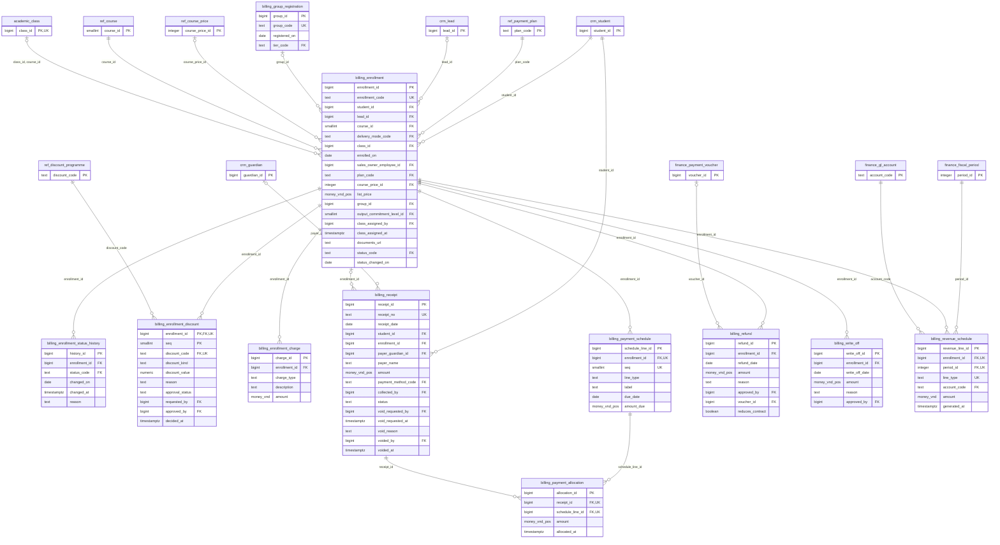
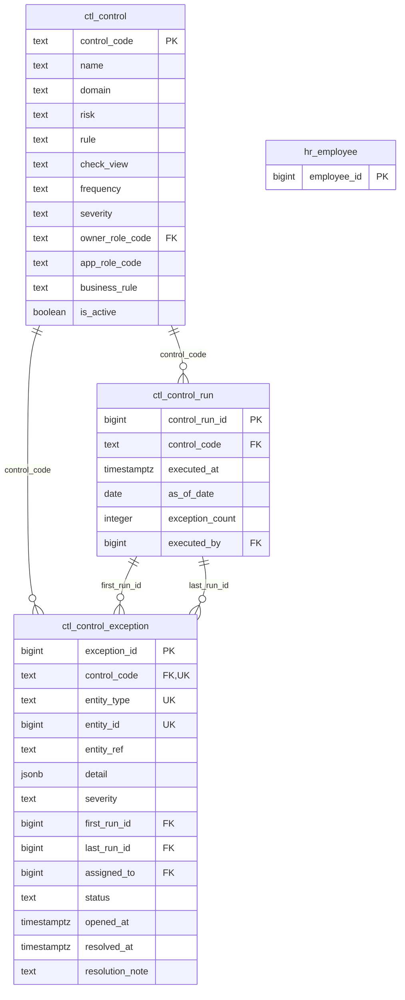
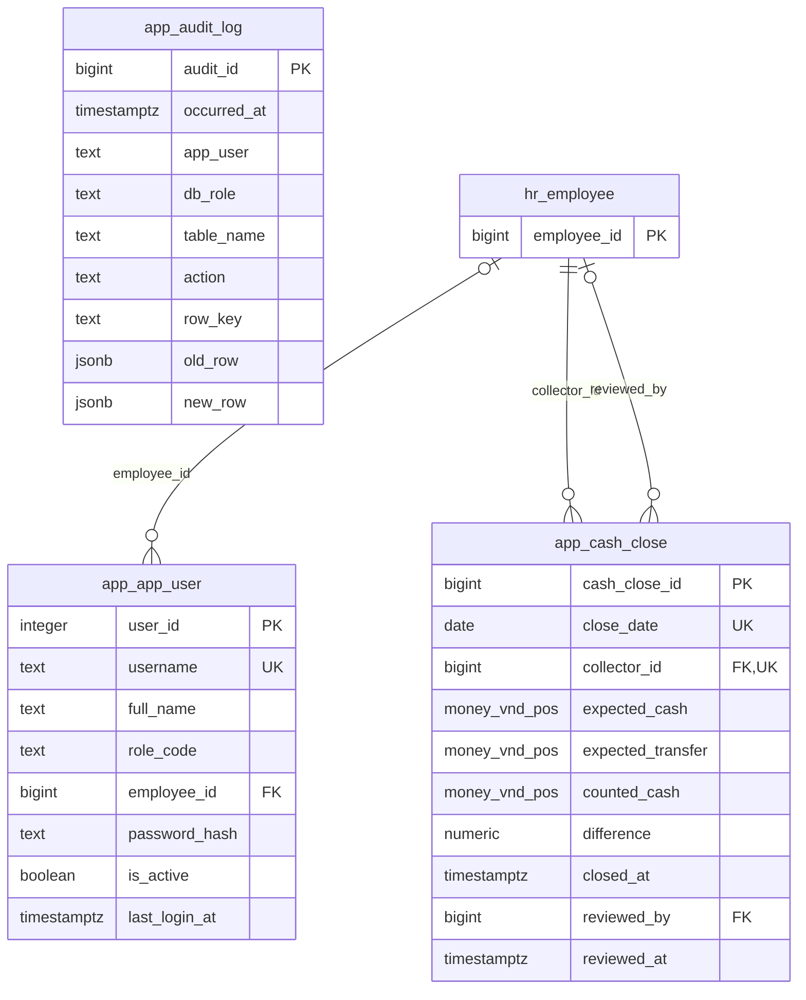

# Entity-relationship diagrams

> Generated by `database/tools/generate_docs.py` from the live catalog - every line below is a real foreign key. Column-level detail (types, constraints, descriptions, legacy lineage) is in [DATA_DICTIONARY.md](DATA_DICTIONARY.md).

**93 tables · 175 foreign keys · 38 views** across 9 schemas. Entity names are `schema_table` (e.g. `billing_enrollment` = `billing.enrollment`).

How to read the crow's-foot notation: `||` exactly one · `|o` zero or one (nullable FK) · `o{` zero or many · `o|` zero or one (unique FK). Labels are the foreign-key columns. In module diagrams, tables from another module appear with their primary key only, and links to small code tables (`ref.*` lookups) and to the employee who approved / confirmed / posted a record (`approved_by`, `confirmed_by`, `posted_by` ...) are omitted to keep the diagrams readable - those columns are still marked `FK`.

## Contents

1. [Core model](#core-model)
2. [Sales & CRM - leads, funnel, placement tests](#sales-crm)
3. [Product catalogue & pricing](#catalogue-pricing)
4. [Academic operations - classes, sessions, staffing](#academic)
5. [Order-to-cash - enrolments, schedules, receipts, revenue](#order-to-cash)
6. [HR & payroll](#hr-payroll)
7. [Finance & accounting - spend, assets, journals, P&L](#finance)
8. [Controls - catalogue, runs, exception queue](#controls)
9. [Application - users, audit trail, daily cash close](#application)
10. [Code tables](#code-tables)

## Core model

The transactional backbone with its key columns (**bold** = primary key, *italic* = foreign key): **lead → enrolment → payment schedule → receipt allocation → revenue schedule**, **class → session → confirmed staff hours → payroll line → payslip**, **voucher line → cost centre / GL account → P&L line**, and the **control → run → exception** queue.

The full model with all 93 tables (keys only) is in [erd/full-model.svg](erd/full-model.svg) - open it and zoom. Both pictures are rendered with Graphviz from [erd/core-model.dot](erd/core-model.dot) and [erd/full-model.dot](erd/full-model.dot).

## Sales & CRM - leads, funnel, placement tests

Replaces the *Customer Master Database* workbook: one customer record per learner, guardians as a separate entity, every lead with its funnel history, activities and placement-test scores.

## Product catalogue & pricing

Programmes, courses, dated price lists, fees, payment-plan templates and discount programmes - the inputs of the pricing engine that the *Qualified Leads* sheet computed with nested formulas.

## Academic operations - classes, sessions, staffing

Replaces *Course Administration*: classes generated from a weekly meeting pattern, every session as a row, staff assigned per class and confirmed hours per session (the source of teaching payroll).

## Order-to-cash - enrolments, schedules, receipts, revenue

Replaces *Qualified Leads* + *Receipts Management*: priced enrolments, payment schedules, receipts allocated to schedule lines (instead of the text key 'AMIxx-Course-Class-Giai doan n'), refunds, write-offs and the accrual revenue schedule.

## HR & payroll

Replaces *Salary Pipeline*, *Working Schedule* and the monthly payslip workbook: HR role codes, salary codes with dated rates, personal overrides, Learning Advisor shifts, payroll runs, payslips, PIT and statutory deductions, commissions.

```mermaid
erDiagram
    hr_employee {
        bigint employee_id PK
        text employee_code UK
        text full_name
        text name_code UK
        text gender
        date date_of_birth
        text phone
        text email
        text employment_type
        text home_cost_center_code FK
        date hire_date
        date end_date
    }
    hr_employee_role {
        bigint employee_role_id PK
        text hr_code UK
        bigint employee_id FK
        text role_code FK
        text contract_stage_code FK
        text salary_code FK
        text cost_center_code FK
        date effective_from
        date effective_to
    }
    hr_employee_rate_override {
        bigint override_id PK
        bigint employee_role_id FK
        money_vnd_pos hourly_rate
        date effective_from
        date effective_to
        text reason
        bigint approved_by FK
    }
    hr_employee_fixed_pay {
        bigint fixed_pay_id PK
        bigint employee_role_id FK
        money_vnd_pos monthly_amount
        date effective_from
        date effective_to
    }
    hr_work_shift {
        bigint shift_id PK
        bigint employee_role_id FK,UK
        date shift_date UK
        time start_time UK
        time end_time
        numeric hours
        numeric deduction_hours
        text status
        bigint confirmed_by FK
        timestamptz confirmed_at
    }
    ref_staff_role {
        text role_code PK
        text name
        text pay_basis
        boolean is_academic
        text hr_code_suffix
    }
    ref_contract_stage {
        text contract_stage_code PK
        text name
    }
    ref_salary_code {
        text salary_code PK,UK
        text role_code FK,UK
        text contract_stage_code FK,UK
    }
    ref_salary_rate {
        integer salary_rate_id PK
        text salary_code FK
        money_vnd_pos hourly_rate
        date effective_from
        date effective_to
    }
    ref_earning_type {
        text earning_type_code PK
        text name
        boolean is_taxable
        boolean is_allowance
    }
    ref_deduction_type {
        text deduction_type_code PK
        text name
    }
    payroll_pit_rule {
        integer pit_rule_id PK
        text employment_type
        money_vnd_pos threshold_amount
        pct rate
        date effective_from
        date effective_to
    }
    payroll_statutory_deduction_rule {
        integer rule_id PK
        text deduction_type_code FK
        text employment_type
        pct employee_rate
        date effective_from
        date effective_to
    }
    payroll_payroll_run {
        bigint run_id PK
        integer period_id FK,UK
        text run_type UK
        text status
        timestamptz calculated_at
        bigint approved_by FK
        timestamptz approved_at
        date paid_on
    }
    payroll_payroll_line {
        bigint payroll_line_id PK
        bigint run_id FK
        bigint employee_id FK
        bigint employee_role_id FK
        text earning_type_code FK
        text programme_code FK
        text delivery_mode_code FK
        numeric quantity_hours
        money_vnd_pos rate
        money_vnd amount
        text source_type
        text account_code FK
        text cost_center_code FK
    }
    payroll_commission {
        bigint commission_id PK
        bigint enrollment_id FK,UK
        bigint employee_id FK
        money_vnd_pos amount
        integer earned_period_id FK
        text status
        bigint run_id FK
    }
    payroll_payslip {
        bigint payslip_id PK
        bigint run_id FK,UK
        bigint employee_id FK,UK
        money_vnd_pos taxable_earnings
        money_vnd_pos allowances
        money_vnd_pos pit_withheld
        money_vnd_pos other_deductions
        money_vnd_pos net_pay
    }
    payroll_payslip_deduction {
        bigint payslip_id PK,FK
        text deduction_type_code PK,FK
        money_vnd_pos amount
    }
    academic_session_staff {
        bigint session_id PK,FK
        bigint employee_role_id PK,FK
    }
    billing_enrollment {
        bigint enrollment_id PK
    }
    finance_fiscal_period {
        integer period_id PK
    }
    finance_gl_account {
        text account_code PK
    }
    finance_cost_center {
        text cost_center_code PK
    }
    hr_employee_role ||--o{ academic_session_staff : "employee_role_id"
    hr_employee |o--o{ billing_enrollment : "class_assigned_by"
    hr_employee |o--o{ billing_enrollment : "sales_owner_employee_id"
    hr_employee |o--o{ finance_cost_center : "manager_employee_id"
    finance_cost_center |o--o{ hr_employee : "home_cost_center_code"
    hr_employee_role ||--o{ hr_employee_fixed_pay : "employee_role_id"
    hr_employee_role ||--o{ hr_employee_rate_override : "employee_role_id"
    ref_contract_stage ||--o{ hr_employee_role : "contract_stage_code"
    finance_cost_center |o--o{ hr_employee_role : "cost_center_code"
    hr_employee ||--o{ hr_employee_role : "employee_id"
    ref_staff_role ||--o{ hr_employee_role : "role_code"
    ref_salary_code |o--o{ hr_employee_role : "salary_code, role_code, contract_stage_code"
    hr_employee_role ||--o{ hr_work_shift : "employee_role_id"
    finance_fiscal_period ||--o{ payroll_commission : "earned_period_id"
    hr_employee ||--o{ payroll_commission : "employee_id"
    billing_enrollment ||--o| payroll_commission : "enrollment_id"
    payroll_payroll_run |o--o{ payroll_commission : "run_id"
    finance_gl_account ||--o{ payroll_payroll_line : "account_code"
    finance_cost_center ||--o{ payroll_payroll_line : "cost_center_code"
    ref_earning_type ||--o{ payroll_payroll_line : "earning_type_code"
    hr_employee ||--o{ payroll_payroll_line : "employee_id"
    hr_employee_role |o--o{ payroll_payroll_line : "employee_role_id"
    payroll_payroll_run ||--o{ payroll_payroll_line : "run_id"
    finance_fiscal_period ||--o{ payroll_payroll_run : "period_id"
    hr_employee ||--o{ payroll_payslip : "employee_id"
    payroll_payroll_run ||--o{ payroll_payslip : "run_id"
    ref_deduction_type ||--o{ payroll_payslip_deduction : "deduction_type_code"
    payroll_payslip ||--o{ payroll_payslip_deduction : "payslip_id"
    ref_deduction_type ||--o{ payroll_statutory_deduction_rule : "deduction_type_code"
    ref_contract_stage ||--o{ ref_salary_code : "contract_stage_code"
    ref_staff_role ||--o{ ref_salary_code : "role_code"
    ref_salary_code ||--o{ ref_salary_rate : "salary_code"
```

## Finance & accounting - spend, assets, journals, P&L

Replaces *Payment Control* and the P&L workbook: fiscal periods with locking, chart of accounts, P&L layout and mapping, cost centres, vendors, claims, vouchers, fixed assets with depreciation, and manual journals.

```mermaid
erDiagram
    finance_fiscal_period {
        integer period_id PK
        date period_start UK
        date period_end
        smallint fiscal_year
        text status
        timestamptz closed_at
    }
    finance_gl_account {
        text account_code PK
        text name
        text account_class
        text parent_account_code FK
        boolean is_postable
        boolean is_capex
        boolean is_depreciation
        text legacy_source
        integer sort_order
    }
    finance_cost_center {
        text cost_center_code PK
        text name
        boolean is_academic
        text programme_code FK
        bigint manager_employee_id FK
        boolean is_active
    }
    finance_pnl_line {
        text pnl_line_code PK
        text name
        text section
        text subsection
        text legacy_line_code
        integer sort_order
    }
    finance_pnl_line_mapping {
        text account_code PK,FK
        text cost_center_scope PK
        text pnl_line_code FK
    }
    finance_revenue_account_map {
        text programme_code PK,FK
        text delivery_mode_code PK,FK
        text account_code FK
    }
    finance_earning_account_map {
        integer map_id PK
        text earning_type_code FK,UK
        text role_code FK,UK
        text programme_code FK,UK
        text delivery_mode_code FK,UK
        text account_code FK
    }
    finance_vendor {
        bigint vendor_id PK
        text vendor_name UK
        text vendor_type
        text tax_code
        text default_account_code FK
        boolean is_active
    }
    finance_expense_claim {
        bigint claim_id PK
        text claim_no UK
        bigint employee_id FK
        text cost_center_code FK
        date submitted_on
        text status
        bigint approved_by FK
        date approved_on
    }
    finance_expense_claim_line {
        bigint claim_line_id PK
        bigint claim_id FK,UK
        smallint line_no UK
        date transaction_date
        text invoice_no
        text description
        text business_purpose
        text vendor_name
        money_vnd_pos amount_excl_vat
        text vat_code FK
        pct vat_rate
        numeric amount_incl_vat
    }
    finance_payment_voucher {
        bigint voucher_id PK
        text voucher_no UK
        date voucher_date
        bigint requested_by FK
        bigint approved_by FK
        bigint payee_vendor_id FK
        bigint payee_employee_id FK
        text funding_source
        text payment_method_code FK
        text invoice_no
        boolean has_invoice
        bigint claim_id FK
        text status
    }
    finance_payment_voucher_line {
        bigint voucher_line_id PK
        bigint voucher_id FK,UK
        smallint line_no UK
        text description
        text business_purpose
        money_vnd_pos amount_excl_vat
        text vat_code FK
        pct vat_rate
        numeric vat_amount
        numeric amount_incl_vat
        integer recognition_period_id FK
        text cost_center_code FK
        text account_code FK
        bigint class_id FK
    }
    finance_fixed_asset {
        bigint asset_id PK
        text asset_code UK
        text asset_name
        text capex_account_code FK
        text charge_account_code FK
        text cost_center_code FK
        bigint voucher_line_id FK
        date acquisition_date
        money_vnd_pos cost
        money_vnd_pos residual_value
        smallint useful_life_months
        integer first_charge_period_id FK
        text status
        date disposed_on
    }
    finance_depreciation_schedule {
        bigint asset_id PK,FK
        integer period_id PK,FK
        money_vnd_pos amount
    }
    finance_journal_entry {
        bigint journal_entry_id PK
        text entry_no UK
        integer period_id FK
        date entry_date
        text basis
        text entry_type
        text description
        text status
        bigint posted_by FK
        timestamptz posted_at
    }
    finance_journal_line {
        bigint journal_line_id PK
        bigint journal_entry_id FK,UK
        smallint line_no UK
        text account_code FK
        text cost_center_code FK
        money_vnd_pos debit
        money_vnd_pos credit
        text memo
    }
    ref_vat_group {
        text vat_code PK
        pct vat_rate
        text description
    }
    hr_employee {
        bigint employee_id PK
    }
    academic_class {
        bigint class_id PK,UK
    }
    billing_refund {
        bigint refund_id PK
    }
    billing_revenue_schedule {
        bigint revenue_line_id PK
    }
    payroll_payroll_line {
        bigint payroll_line_id PK
    }
    finance_payment_voucher |o--o{ billing_refund : "voucher_id"
    finance_gl_account ||--o{ billing_revenue_schedule : "account_code"
    finance_fiscal_period ||--o{ billing_revenue_schedule : "period_id"
    hr_employee |o--o{ finance_cost_center : "manager_employee_id"
    finance_fixed_asset ||--o{ finance_depreciation_schedule : "asset_id"
    finance_fiscal_period ||--o{ finance_depreciation_schedule : "period_id"
    finance_gl_account ||--o{ finance_earning_account_map : "account_code"
    finance_cost_center ||--o{ finance_expense_claim : "cost_center_code"
    hr_employee ||--o{ finance_expense_claim : "employee_id"
    finance_expense_claim ||--o{ finance_expense_claim_line : "claim_id"
    ref_vat_group ||--o{ finance_expense_claim_line : "vat_code"
    finance_gl_account ||--o{ finance_fixed_asset : "capex_account_code"
    finance_gl_account ||--o{ finance_fixed_asset : "charge_account_code"
    finance_cost_center ||--o{ finance_fixed_asset : "cost_center_code"
    finance_fiscal_period ||--o{ finance_fixed_asset : "first_charge_period_id"
    finance_payment_voucher_line |o--o{ finance_fixed_asset : "voucher_line_id"
    finance_gl_account |o--o{ finance_gl_account : "parent_account_code"
    finance_fiscal_period ||--o{ finance_journal_entry : "period_id"
    finance_gl_account ||--o{ finance_journal_line : "account_code"
    finance_cost_center |o--o{ finance_journal_line : "cost_center_code"
    finance_journal_entry ||--o{ finance_journal_line : "journal_entry_id"
    finance_expense_claim |o--o{ finance_payment_voucher : "claim_id"
    hr_employee |o--o{ finance_payment_voucher : "payee_employee_id"
    finance_vendor |o--o{ finance_payment_voucher : "payee_vendor_id"
    finance_gl_account ||--o{ finance_payment_voucher_line : "account_code"
    academic_class |o--o{ finance_payment_voucher_line : "class_id"
    finance_cost_center ||--o{ finance_payment_voucher_line : "cost_center_code"
    finance_fiscal_period ||--o{ finance_payment_voucher_line : "recognition_period_id"
    ref_vat_group ||--o{ finance_payment_voucher_line : "vat_code"
    finance_payment_voucher ||--o{ finance_payment_voucher_line : "voucher_id"
    finance_gl_account ||--o{ finance_pnl_line_mapping : "account_code"
    finance_pnl_line ||--o{ finance_pnl_line_mapping : "pnl_line_code"
    finance_gl_account ||--o{ finance_revenue_account_map : "account_code"
    finance_gl_account |o--o{ finance_vendor : "default_account_code"
    finance_cost_center |o--o{ hr_employee : "home_cost_center_code"
    finance_gl_account ||--o{ payroll_payroll_line : "account_code"
    finance_cost_center ||--o{ payroll_payroll_line : "cost_center_code"
```

## Controls - catalogue, runs, exception queue

New in the relational model: each control is a check view (`ctl.v_chk_*`); a run stores the exceptions it found so they can be assigned, tracked and resolved.

## Application - users, audit trail, daily cash close

Added for the web application: sign-in accounts mapped to the five roles, the audit trail written by triggers (BR-12) and the daily cash close that compensates for staff handling cash.

## Code tables

Small reference tables with readable codes as primary keys (enumerations). They replace the drop-down lists of the workbooks.

| Table | Description | Used by |
|---|---|---|
| `academic.closure_day` | Days the centre is closed (public holidays, Lunar New Year). No session is generated on these days. |  |
| `payroll.commission_rule` | Configurable sales-commission rules (spec section 6: commission must follow an explicit rule, not a hard-coded rate). |  |
| `ref.acquisition_channel` | Marketing acquisition channels ("how did the customer hear about AMI"). | `crm.lead` |
| `ref.app_setting` | Key/value application settings (e.g. the reporting as-of date used by status views). |  |
| `ref.consultation_outcome` | Outcome of the latest consultation call/meeting. | `crm.lead`, `crm.lead_activity` |
| `ref.enrollment_status` | Life-cycle statuses of an enrolment. | `billing.enrollment`, `billing.enrollment_status_history` |
| `ref.lead_stage` | Sales-funnel stages of a lead (contact and placement-test progress). | `crm.lead`, `crm.lead_stage_history` |
| `ref.lost_reason` | Reasons a lead did not enrol. | `crm.lead` |
| `ref.payment_method` | Payment methods accepted on receipts and vouchers. | `billing.receipt`, `finance.payment_voucher` |
| `ref.qualification_status` | Lead qualification after consultation (separated from enrolment status - legacy mixed both in one column). | `crm.lead` |
| `ref.relationship_type` | Relationship between a learner and a guardian/payer. | `crm.student_guardian` |
| `ref.school` | Schools attended by learners; partner schools carry an MoU. | `crm.student` |
