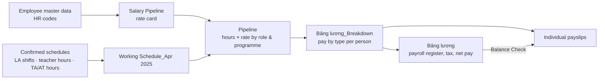

# 03: HR: payroll pipeline

**Workbook:** [`03_Monthly_Payslip_Apr_2025.xlsx`](../workbooks/03_Monthly_Payslip_Apr_2025.xlsx) (one workbook per month)
**Architecture blocks:** *Payroll Management System*. Teaching payroll ✓ · Non-teaching payroll ✓, fed by *Working Schedule Management System* ✗ input

## Purpose

This workbook turns confirmed working hours into payslips without any manual arithmetic. Most staff at AMI were paid by the hour, with rates that depend on **role**, **programme** and **contract stage** (probation vs official). Some people held several roles (for example, LA and TA).

## Flow

## Keys

- **Name code:** the given name plus the initials of the other names (e.g. `Nhung NK`). Used across all workbooks for staff.
- **HR code:** the name code without spaces or accents, plus role and sequence number (e.g. `NHUNGNKLA004` = person as *Learning Advisor*, `NHUNGNKTA001` = same person as *TA*). One person can have several HR codes, one per role.
- **Salary code:** `S/L.001` to `S/L.010`, one per role × contract stage:

| Code | Role |
|---|---|
| S/L.001 / S/L.002 | Learning Advisor (probation / official) |
| S/L.003 / S/L.005 | IELTS assistant teacher (probation / official) |
| S/L.004 / S/L.006 | Applied English / Communication TA (probation / official) |
| S/L.007 / S/L.009 | Applied English / Communication teacher (probation / official) |
| S/L.008 / S/L.010 | IELTS teacher (probation / official) |

## Sheets

| Sheet | Logic |
|---|---|
| `Salary Pipeline` *(hidden)* | Rate card per HR code × salary code, imported from the employee master file |
| `Working Schedule_Apr 2025` | Confirmed hours imported from the LA schedule (shifts, hours, deductions) and the teacher/TA schedules (hours by programme: IELTS, Applied English, Communication), each with a confirmation flag |
| `Pipeline` | For each HR code: rates pulled with `FILTER(INDEX(...MATCH(HR code)...), header = salary code)`. Hours pulled with `XLOOKUP(HR code, schedule)`. Pay = hours × rate for each role-programme pair |
| `Bảng lương_Breakdown` | `SUMIF` by person across all their HR codes into pay types: LA pay, teacher pay (AE/COMM/IELTS), TA/AT pay, sales commission, overtime, non-teaching staff pay, marketing pay, non-teaching activities, centre manager, foreign teacher. Commission and overtime are manual inputs |
| `Bảng lương` | Payroll register: base pay, commission, overtime, other pay, allowances (lunch, phone, business travel, transport) → taxable income → **PIT withholding 10% if income > 2,000,000 VND** → net pay. A **Balance Check** column compares each net pay with the individual payslip and returns `YES`/`NO` |
| One sheet per employee | Printable monthly payslip: shifts, hours, deductions, rate, gross pay, commission, overtime, other pay, insurance lines, tax and net pay |

## Why it matters

- One rate card and one set of confirmed hours produce both the payroll register and every payslip. There is no double entry.
- The Balance Check catches any mismatch between the register and an individual payslip before payment.
- Monthly pay by type flows into the P&L workbook's `Salary Expense` sheet. There it is split into teaching costs (cost of sales) and staff costs (operating expenses).

## Glossary

| Vietnamese | English |
|---|---|
| Bảng lương | Payroll register |
| Số ca làm / Số giờ làm | Shifts worked / Hours worked |
| Khấu trừ giờ làm | Hour deduction |
| Thử việc / Chính thức | Probation / Official contract |
| Hoa hồng bán hàng | Sales commission |
| Lương ngoài giờ | Overtime pay |
| Phụ cấp (ăn trưa, điện thoại, công tác phí, đi lại) | Allowances (lunch, phone, business travel, transport) |
| Thuế TNCN | Personal income tax (PIT) |
| Thực lĩnh | Net pay |
